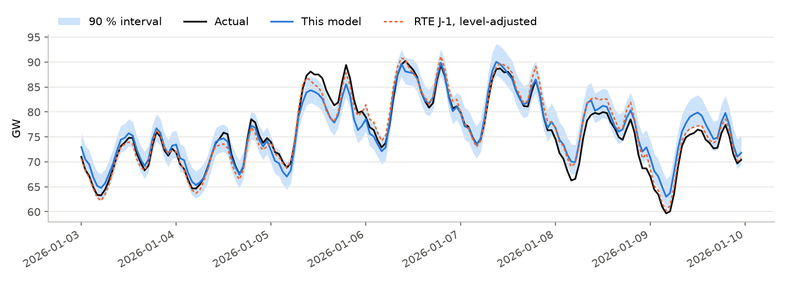
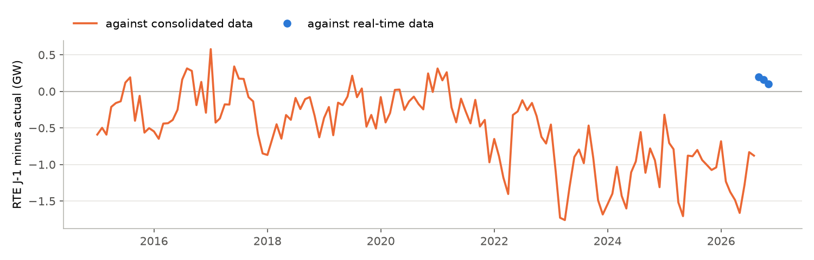
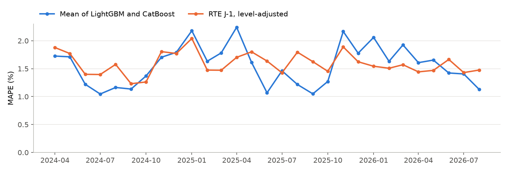
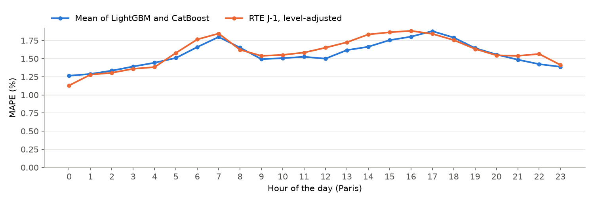
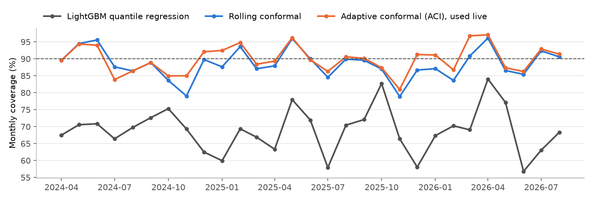

# France Load Forecasting

[](https://github.com/Zeta-12/france-load-forecasting/actions/workflows/ci.yml)
[](https://github.com/Zeta-12/france-load-forecasting/actions/workflows/daily.yml)

Hourly forecast of the electricity consumption of mainland France for the next day, made every morning with the
information a grid operator has at that time, and compared with RTE's own day-ahead forecast (J-1). The load comes
from RTE eCO2mix, the weather from Open-Meteo (ERA5 reanalysis and archived ECMWF IFS forecasts). The forecast runs
every day on GitHub Actions and is published on a [dashboard](https://zeta-12.github.io/france-load-forecasting/).



*3 to 9 January 2026, the week with the highest consumption of the test period.*

In short:

- Over 29 months (April 2024 to August 2026), with weather forecasts issued the day before, the mean of a LightGBM
  and a CatBoost model gets 1.56 % MAPE (789 MW MAE). RTE's J-1 gets 1.59 % once it is put on the level of the
  series it is scored against, and 2.70 % as published ([results](#point-forecasts)).
- RTE forecasts the real-time consumption, and since 2023 this series is about 1.1 GW below the consolidated one
  that the history is made of, which explains most of the 2.70 %. On the real-time data of September to
  November 2026, RTE is better than the model: 1.33 % against 1.44 %.
- The two forecasts don't make the same errors. Their average gets 1.27 % on the test period and 1.17 % on the
  real-time data, about 20 % less than either.
- The conformal intervals cover 89.9 % of the hours for a 90 % target. LightGBM quantile regression alone covers
  69 % ([intervals](#prediction-intervals)).

## Setup

| | |
|---|---|
| Target | hourly consumption of mainland France (RTE eCO2mix, mean of the :00 and :30 values), MW |
| Issue time | D-1 at 10:00 (Paris), for the 24 hours of day D |
| Load known at issue time | up to D-1 09:00 |
| Weather of day D | ECMWF IFS 0.25 deg forecast issued the day before (Open-Meteo previous runs API), 12 points (one per mainland region) weighted by population |
| Weather before D | ERA5 reanalysis |
| Training data | 2015 to D-2, without the first covid lockdown |
| Test period | 2024-04-01 to 2026-08-31 (29 months of consolidated data), refit at the start of every month |
| Validation | 2023, with observed weather. The target, features, models and interval method were chosen on it |

Features: calendar (hour, day of week, day of year, public holidays and the days around them, "ponts", christmas
week, whether D-2 and D-7 were holidays), consumption lags (same hour 1, 2 and 7 days before, D-1 morning, daily
means of D-2 and D-7) and the weather of day D (temperature with 12 h and 48 h exponential smoothing, daily min /
mean / max, radiation, wind). The target is the difference to the same hour one week before, and the other lags are
given as differences to that value too (finding 4).

`tests/test_features.py` checks the cut-off: changing the load after D-1 09:00, or the observed weather of D, does
not change any feature of D.

## Results

### Point forecasts

2024-04-01 to 2026-08-31, 21 192 hours, day-1 weather forecasts.

| | MAPE (%) | MAE (MW) | RMSE (MW) | Bias (MW) | Daily peak MAE (MW) |
|---|---|---|---|---|---|
| Same hour last week | 6.13 | 3201 | 4675 | 76 | 3306 |
| LightGBM | 1.64 | 834 | 1155 | 78 | 889 |
| CatBoost | 1.58 | 799 | 1078 | 93 | 846 |
| **Mean of LightGBM and CatBoost (used live)** | **1.56** | **789** | 1076 | 86 | **843** |
| RTE J-1, as published | 2.70 | 1322 | 1651 | -1065 | 1586 |
| RTE J-1, level-adjusted (see 1) | 1.59 | 792 | 1039 | 6 | 875 |
| Mean of this model and RTE J-1 (adjusted) | 1.27 | 640 | 862 | 46 | 709 |

2026-09-08 to 2026-11-07, 1 465 hours of real-time data (the first 61 days after the end of the consolidated data,
replayed with the same protocol):

| | MAPE (%) | MAE (MW) | RMSE (MW) | Bias (MW) | Daily peak MAE (MW) |
|---|---|---|---|---|---|
| Mean of LightGBM and CatBoost | 1.44 | 674 | 931 | 129 | 673 |
| RTE J-1, as published | 1.33 | 608 | 780 | 189 | 631 |
| Mean of this model and RTE J-1 | 1.17 | 543 | 717 | 159 | 553 |

All the tables, with the ablations: [`results.md`](docs/assets/results.md).

1. **RTE's J-1 is made for the real-time series, and since 2023 that series is about 1.1 GW below the consolidated
   one.** RTE publishes the consumption twice: in real time from telemetry, then a few months later consolidated
   from metering data. Only the consolidated data has a history, so the models are fitted and scored on it. Against
   it, RTE's J-1 had a mean error between -0.1 and -0.4 GW every year from 2015 to 2021, -0.6 GW in 2022 and -1.0 to
   -1.2 GW from 2023 to 2026, and its MAPE went from about 1.5 % to 2.7 %. Against the real-time data of September
   to November 2026, its mean error is between +0.1 and +0.2 GW, so most of the drift comes from the gap between the
   two series. The gap also depends on the hour: in 2024 RTE's J-1 is more than 1 GW below the consolidated load at
   night, about 1.9 GW below between 13:00 and 17:00 and 1.5 to 1.7 GW at 20:00-21:00, but less than 0.2 GW at
   6:00-7:00. I haven't found where RTE documents the difference. To compare the two forecasts on the same series,
   the level-adjusted J-1 adds RTE's mean error of the last 28 days, per hour of the day, using the data up to D-2
   like the models. That brings it from 2.70 % to 1.59 %.

   

2. **The model is on par with RTE on consolidated data and a bit worse on real-time data.** Over the 29 months the
   MAPE is 1.56 % against 1.59 % and the MAE is the same, but RTE has a lower RMSE (1039 against 1076 MW): it makes
   fewer large errors. The model is better in summer (1.0 to 1.2 % in most summer months, against 1.2 to 1.8 %) and
   worse from November to April in 2025 and 2026, up to 2.2 % against 1.5 to 1.9 % (figure below). On the 61 days
   of real-time data RTE gets 1.33 % against 1.44 %, on a short sample without a winter.
3. **The two forecasts make different errors.** Their average gets 1.27 % on the test period and 1.17 % on the
   real-time data, about 20 % less than each of them. The model only knows 12 weather points and the calendar, so I
   didn't expect it to add much to RTE's forecast, but its errors are far from RTE's.
4. **A model of the absolute load is too high after the 2022-2023 drop, until it has seen enough of the new
   level.** Mean consumption went
   from 53.5 GW in 2021 to 49.7 GW in 2023 (-7 %, not corrected for the weather). On 2023, the validation year, a
   LightGBM of the absolute load over-forecasts by 940 MW on average (2.14 % MAPE), mostly in cold weather. Trees
   can't extrapolate, and the model has seen 8 years of the old level and a few months of the new one. Recency
   weights (half-life of one year) only bring it to 2.05 %. Predicting the difference to the same hour one week
   before doesn't help as long as the other lags stay absolute (2.28 %), because the trees still split on their
   level. Once they are given as differences too, the error drops to 1.62 % (1.60 % with the holiday flags of D-2
   and D-7). On the test period, which starts after 1.5 years of the new level, both targets get the same MAPE
   (1.63 % and 1.64 %), but the absolute one keeps a +250 MW bias against +80 MW. I kept the relative target for
   the next break.
5. **The offset between ERA5 and the IFS forecasts costs as much as the weather forecast error.** With the observed
   weather (ERA5) of day D, LightGBM gets 1.59 %, with the day-1 IFS forecast 1.64 % and with the day-2 forecast
   1.66 %. But the model is fitted on ERA5 and fed IFS forecasts, and the two don't agree on average: in February
   and March 2024, before the test period, IFS was 0.5 C colder than ERA5 on the same hours and its cloud cover was
   17 points lower. With the raw forecasts, LightGBM gets 1.69 % with a +200 MW bias. So cloud cover is left out,
   and temperature, radiation and wind are corrected by their mean forecast - ERA5 difference over the last 28 days,
   per hour of the day. That uses ERA5 up to D-7, as it is published with a ~5 day delay.

| Weather of day D (LightGBM) | MAPE (%) | MAE (MW) | Bias (MW) |
|---|---|---|---|
| ERA5, observed (upper bound) | 1.59 | 801 | 72 |
| IFS day-1 forecast, debiased | 1.64 | 834 | 78 |
| IFS day-2 forecast, debiased | 1.66 | 846 | 78 |
| IFS day-1 forecast, raw | 1.69 | 856 | 203 |

### Error analysis

<p>


</p>

The 10 worst days of the test period are in [`results.md`](docs/assets/results.md#worst-days-mean-of-lightgbm-and-catboost).

- The worst one is 22 November 2025: 8.3 % against 2.9 % for RTE. The temperature dropped by 13 C in a week (13.6 C
  on the 15th, 0.5 C on the 22nd, and the forecast was within 1 C), consumption went up by 22.8 GW, and the model was
  5.7 GW too low. 14 January 2026 is the same case the other way round: +9.9 C and -19.3 GW in a week, 3.5 GW too
  high. With a target relative to last week the model has to extrapolate there, because week-to-week changes of
  more than 10 C only happen on 18 days of the 2015-2023 training data. Mixing in the absolute model, or anchoring on
  a closer day, should help on these days. I haven't tried it yet.
- Christmas Eve 2024: 3.1 GW too high, against 1.4 % for RTE. The model has one flag for the whole 24 December - 1
  January period and only 9 Christmas Eves to learn from.
- Three spring Sundays (2025-04-13, 2026-04-19, 2026-05-03) and 1 May 2025 are around 5 % for both forecasts, and
  the model is about 2 GW off on each of them. Sunshine doesn't explain it: the first one was the least sunny spring
  Sunday of the test period and 1 May 2025 was sunny. I don't know the cause yet.

### Prediction intervals

90 % intervals, 2024-04-25 to 2026-08-31 (the first 24 days are the calibration warm-up). All the conformal methods
only use the residuals of days D-29 to D-2, the last complete days at issue time.

| | Coverage (%) | Worst month (%) | Mean width (MW) | Width (% of load) | Interval score (MW) |
|---|---|---|---|---|---|
| LightGBM quantile regression (5 % and 95 %) | 69.1 | 56.8 | 2495 | 5.0 | 6604 |
| Rolling conformal, per hour of the day | 92.5 | 83.3 | 3960 | 7.8 | 4858 |
| Rolling conformal | 88.5 | 78.9 | 3303 | 6.6 | 4730 |
| **Adaptive conformal (ACI, used live)** | **89.9** | 81.0 | 3561 | 7.1 | **4732** |
| Conformalized quantile regression | 89.6 | 79.3 | 4042 | 8.0 | 5366 |



- Quantile regression alone covers 69 % of the hours. Its quantiles are learned on the training data, with observed
  weather, and the errors on new days with forecast weather are larger.
- Split conformal on a sliding window of 28 days gets close to the target (88.5 %). Adaptive conformal inference
  (Gibbs and Candes, 2021) adjusts the miscoverage level every day from the misses of D-2, which brings it to
  89.9 % for a slightly wider interval and the same interval score. The method, the window and the ACI step (0.01)
  were chosen on the 2023 validation residuals.
- The monthly coverage still goes from 81 % to 97 %. The misses come in groups, like the November 2025 cold snap,
  and a 28-day window only adapts after the fact.
- Per-hour quantiles are too wide: with 28 values per hour, the finite-sample correction picks the min and the max.

## Live forecast

[`daily.yml`](.github/workflows/daily.yml) runs every morning on GitHub Actions:

1. update the RTE data, ERA5 and the archived forecasts, and get the latest ECMWF run;
2. replay the last 60 days as a small backtest (same monthly refits, archived day-1 weather) to get out-of-sample
   residuals for the intervals;
3. fit LightGBM and CatBoost on everything up to D-2 and forecast D with their mean;
4. commit the forecast to the [`forecasts`](https://github.com/Zeta-12/france-load-forecasting/tree/forecasts)
   branch, together with the real-time load as first published (RTE replaces it with consolidated data a few
   months later, see finding 1), and redeploy the dashboard.

The live forecast and its score are on the real-time series, like RTE's J-1. The target is relative to last week, so
the forecast follows the level of the data it is fed: on the real-time replay above its bias is +130 MW, against
+190 MW for RTE. The raw data (~30 MB) is kept in the Actions cache. A cold cache means a full download of about 10
minutes, mostly ERA5.

## Reproduce

```bash
uv sync
uv run flf fetch                       # RTE + Open-Meteo, ~15 min the first time (API quotas)
uv run flf backtest --weather day1 --models naive_week lightgbm catboost lightgbm_q05 lightgbm_q95
uv run flf backtest --weather obs --models lightgbm
uv run flf backtest --weather day2 --models lightgbm
uv run flf backtest --weather day1 --no-debias --tag day1_raw --models lightgbm
uv run flf backtest --weather day1 --tag day1_abs --models lightgbm_abs
uv run flf backtest --weather day1 --tag realtime --start 2026-09-08 --end 2026-11-07 --models lightgbm catboost lightgbm_abs
uv run flf report                      # tables and figures in docs/assets/
uv run flf live --archive archive --site site
```

On a laptop CPU (Intel Core Ultra 5 235U) one month of the backtest takes about a minute per model, so the main
backtest takes about an hour. On this CPU LightGBM is 2.5x slower with all 14 threads than with 4, hence `n_jobs: 4`.

## Layout

```
src/load_forecast/
  rte.py          eCO2mix download and cleaning (DST duplicates, hourly means)
  weather.py      Open-Meteo: ERA5, archived and live forecasts, national mean, forecast - ERA5 correction
  calendar.py     holidays, bridges, christmas week
  features.py     feature table with the issue-time cut-off
  models.py       naive baseline, LightGBM / CatBoost with the relative target
  backtest.py     monthly-refit backtest
  conformal.py    rolling split conformal, ACI, CQR, RTE level adjustment
  report.py       README tables and figures
  live.py         daily run and forecast archive
  site.py         dashboard
```

## Limitations

- The backtest uses consolidated data for the lags, while only the real-time series is known at 10:00 on D-1. The
  61 real-time days are the only check of the switch between the two.
- The archived day-1 weather is the forecast issued about 24 h before the valid time. At 10:00 on D-1 the latest
  run is the 00 UTC one, so for the evening of D the real lead time is closer to 46 h. The day-2 run (1.66 %) gives
  the other bound.
- The smoothed temperature uses the ERA5 of the afternoon of D-1, a few hours more than what is known at issue time.
- Twelve points for the weather of a whole country. RTE uses its own national temperature, built from many more
  stations.
- No school holidays, no Tempo red days, nothing about industrial activity.

## Data and licences

- RTE eCO2mix national data, from [ODRE](https://odre.opendatasoft.com/explore/dataset/eco2mix-national-cons-def/):
  Licence Ouverte v2.0.
- Weather: [Open-Meteo](https://open-meteo.com/) (CC BY 4.0), with ERA5 (Copernicus) and ECMWF IFS open data.
- Code: Apache-2.0.

This project is not affiliated with RTE.
